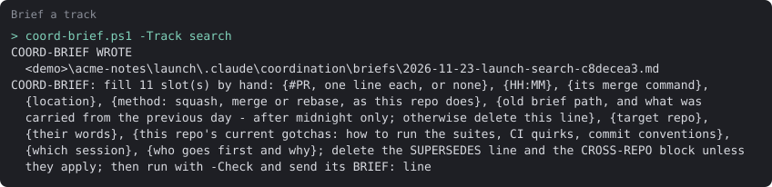
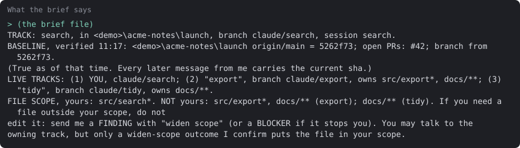
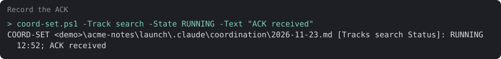
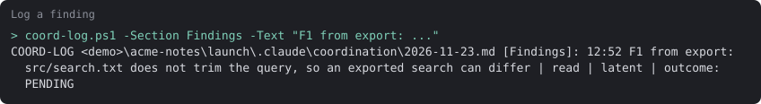
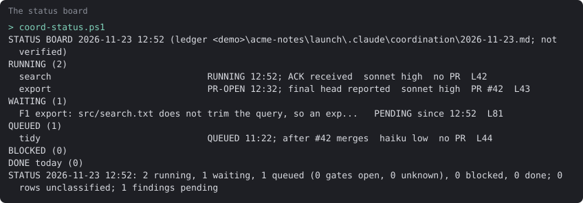
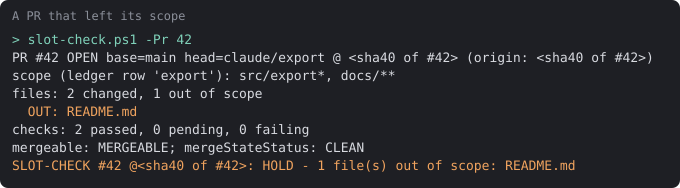
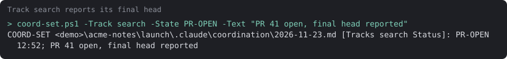
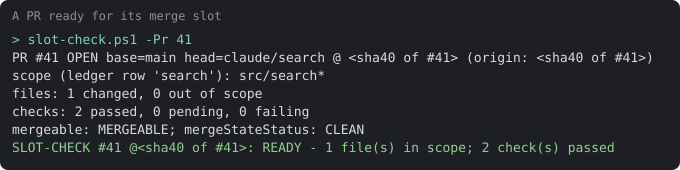

# A coordinator day: real script output on a made-up repo

A made-up repo (`acme-notes`) with three made-up tracks: `search`, `export` and `tidy`. Each step
below is the real output of the plugin's scripts against that repo and its ledger. gh is the test stub,
answering with made-up PRs, so nothing here talked to GitHub. The temp folder is shown as `<demo>`,
and a full 40-character head sha as `<sha40 of #n>` (the scripts print the sha itself).
Regenerate with `powershell -NoProfile -ExecutionPolicy Bypass -File docs\demo\make-demo.ps1`; times
and shas change on every run. `launch` in the paths is the fixture's name for the repo's main checkout,
where the coordinator and its ledger live.

## Brief a track

The coordinator renders the brief for track `search` from the ledger: baseline, scope, siblings and their files. The slots the ledger cannot answer (this repo's merge command, its gotchas, who goes first) are filled in by the coordinator session, not typed by the user; `-Check` then refuses a brief with a slot left, and prints the one pointer line the track gets. The track answers `ACK search`.



```text
> coord-brief.ps1 -Track search
COORD-BRIEF WROTE <demo>\acme-notes\launch\.claude\coordination\briefs\2026-11-23-launch-search-c8decea3.md
COORD-BRIEF: fill 11 slot(s) by hand: {#PR, one line each, or none}, {HH:MM}, {its merge command}, {location}, {method: squash, merge or rebase, as this repo does}, {old brief path, and what was carried from the previous day - after midnight only; otherwise delete this line}, {target repo}, {their words}, {this repo's current gotchas: how to run the suites, CI quirks, commit conventions}, {which session}, {who goes first and why}; delete the SUPERSEDES line and the CROSS-REPO block unless they apply; then run with -Check and send its BRIEF: line
```

## What the brief says

The parts of the rendered brief that the ledger answered. The rest (house rules, merge order, report shape) comes from the template.



```text
> (the brief file)
TRACK: search, in <demo>\acme-notes\launch, branch claude/search, session search.
BASELINE, verified 11:17: <demo>\acme-notes\launch origin/main = 5262f73; open PRs: #42; branch from 5262f73.
(True as of that time. Every later message from me carries the current sha.)
LIVE TRACKS: (1) YOU, claude/search; (2) "export", branch claude/export, owns src/export*, docs/**; (3) "tidy", branch claude/tidy, owns docs/**.
FILE SCOPE, yours: src/search*. NOT yours: src/export*, docs/** (export); docs/** (tidy). If you need a file outside your scope, do not
edit it: send me a FINDING with "widen scope" (or a BLOCKER if it stops you). You may talk to the
owning track, but only a widen-scope outcome I confirm puts the file in your scope.
```

## Record the ACK

The Status cell is written with a time from the clock, never a typed one. The owed check for the ACK is ticked by hand.



```text
> coord-set.ps1 -Track search -State RUNNING -Text "ACK received"
COORD-SET <demo>\acme-notes\launch\.claude\coordination\2026-11-23.md [Tracks search Status]: RUNNING 12:52; ACK received
```

## Log a finding

Track `export` noticed something outside its scope. It reports a FINDING instead of fixing it; the coordinator logs it, and the user decides what it becomes.



```text
> coord-log.ps1 -Section Findings -Text "F1 from export: ..."
COORD-LOG <demo>\acme-notes\launch\.claude\coordination\2026-11-23.md [Findings]: 12:52 F1 from export: src/search.txt does not trim the query, so an exported search can differ | read | latent | outcome: PENDING
```

## The status board

One read of the ledger, grouped. Every line ends in the ledger line it came from. `tidy` shares `docs/**` with `export`, so it is queued until #42 merges instead of running alongside it. "not verified": without `-Verify` the board does not check its claims against gh.



```text
> coord-status.ps1
STATUS BOARD 2026-11-23 12:52 (ledger <demo>\acme-notes\launch\.claude\coordination\2026-11-23.md; not verified)
RUNNING (2)
  search                             RUNNING 12:52; ACK received  sonnet high  no PR  L42
  export                             PR-OPEN 12:32; final head reported  sonnet high  PR #42  L43
WAITING (1)
  F1 export: src/search.txt does not trim the query, so an exp...   PENDING since 12:52  L81
QUEUED (1)
  tidy                               QUEUED 11:22; after #42 merges  haiku low  no PR  L44
BLOCKED (0)
DONE today (0)
STATUS 2026-11-23 12:52: 2 running, 1 waiting, 1 queued (0 gates open, 0 unknown), 0 blocked, 0 done; 0 rows unclassified; 1 findings pending
```

## A PR that left its scope

Track `export` reports its final head. slot-check reads the real file list: README.md is outside the row's scope, so no slot is granted.



```text
> slot-check.ps1 -Pr 42
PR #42 OPEN base=main head=claude/export @ <sha40 of #42> (origin: <sha40 of #42>)
scope (ledger row 'export'): src/export*, docs/**
files: 2 changed, 1 out of scope
  OUT: README.md
checks: 2 passed, 0 pending, 0 failing
mergeable: MERGEABLE; mergeStateStatus: CLEAN
SLOT-CHECK #42 @<sha40 of #42>: HOLD - 1 file(s) out of scope: README.md
```

## Track search reports its final head

The track has pushed, opened PR #41 and reported its head; the coordinator records the state (coord-set writes the Status and Model cells only, so the PR cell gets #41 by hand).



```text
> coord-set.ps1 -Track search -State PR-OPEN -Text "PR 41 open, final head reported"
COORD-SET <demo>\acme-notes\launch\.claude\coordination\2026-11-23.md [Tracks search Status]: PR-OPEN 12:52; PR 41 open, final head reported
```

## A PR ready for its merge slot

In scope, checks green, contains the newest main. The coordinator sends the track `SLOT #41 @<sha40>`; the user types the go in the track's own window, and the merge is bound to that sha.



```text
> slot-check.ps1 -Pr 41
PR #41 OPEN base=main head=claude/search @ <sha40 of #41> (origin: <sha40 of #41>)
scope (ledger row 'search'): src/search*
files: 1 changed, 0 out of scope
checks: 2 passed, 0 pending, 0 failing
mergeable: MERGEABLE; mergeStateStatus: CLEAN
SLOT-CHECK #41 @<sha40 of #41>: READY - 1 file(s) in scope; 2 check(s) passed
```
